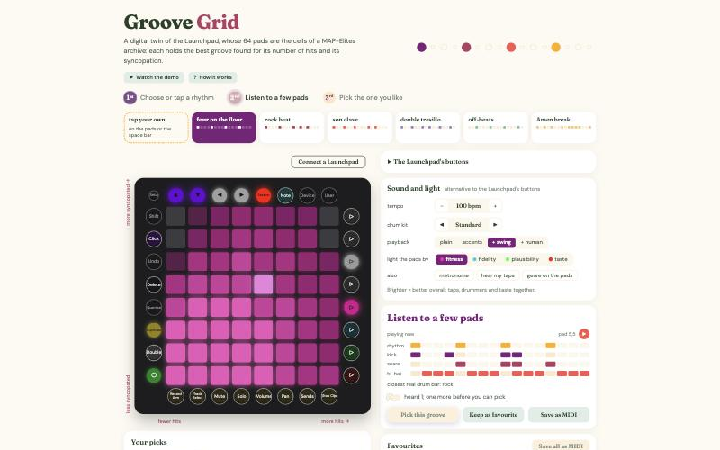
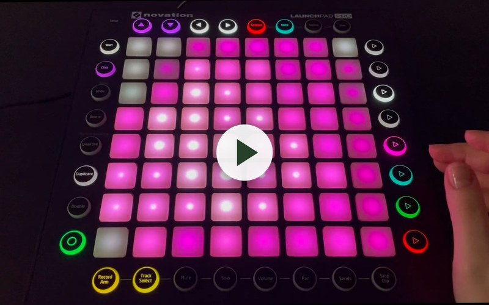

# Groove Grid

Supplementary material for a paper under double-blind review: an interactive web page and a demo video.

<table>
<tr>
<td align="center" width="50%">
 
<a href="https://groove-grid-demo.github.io/groove-grid/"><b>Open the interactive page &rarr;</b></a>
</td>
<td align="center" width="50%">
 
<a href="https://groove-grid-demo.github.io/groove-grid/demo.mp4"><b>Watch the demo video (3 min) &rarr;</b></a>
</td>
</tr>
</table>

## Before you start

- Use a laptop or desktop computer, with headphones or speakers.
- Nothing to install and no account needed: the page runs in the browser.
- The first time you open the page, a short tour shows its main parts. To see it again, click **? How it works**.
- A grid controller is optional; the page works on its own. To connect one, use Chrome or Edge.

## Files

| File | What it is |
|---|---|
| `index.html` | the interactive page |
| `demo.mp4` | the demo video |
